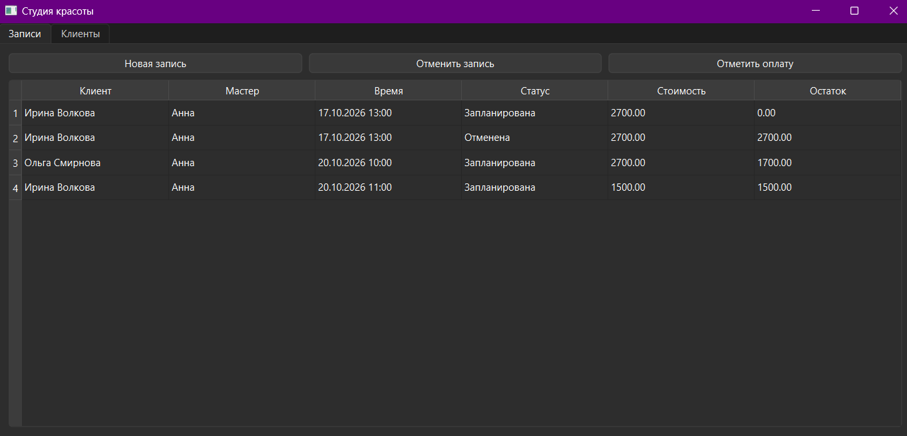
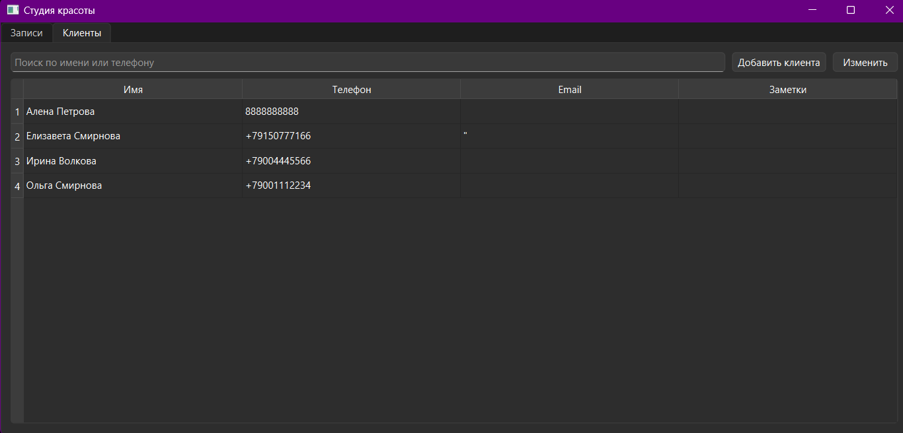
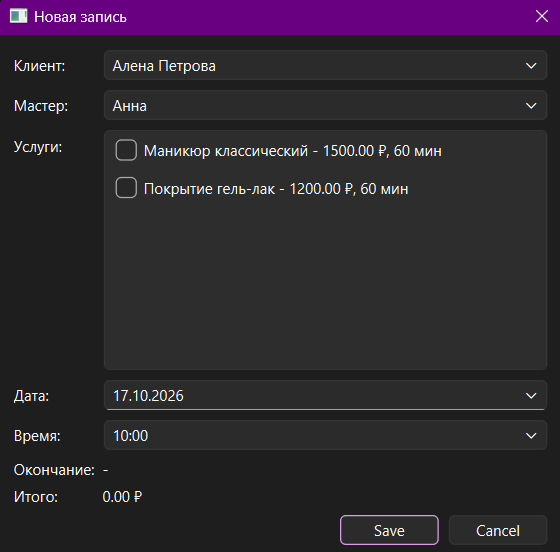
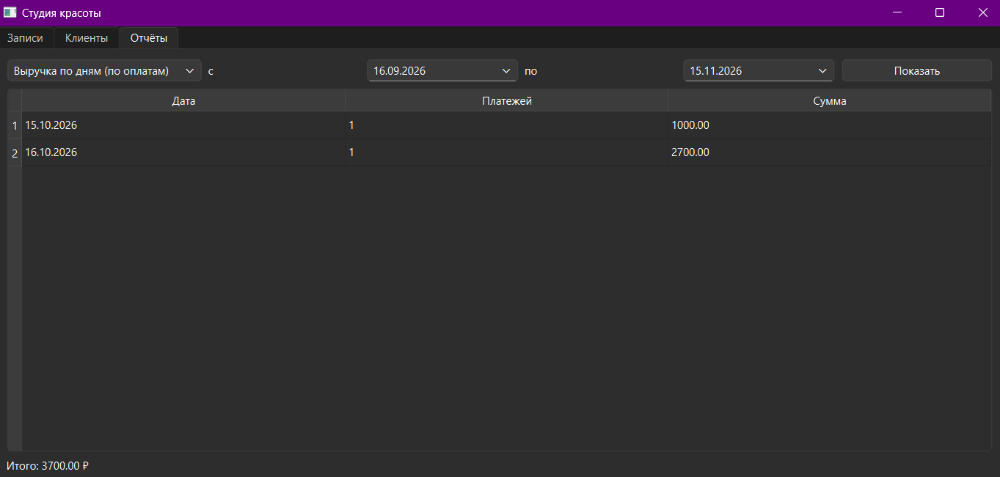
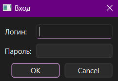
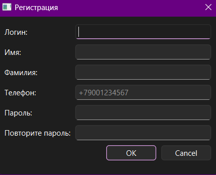

# Студия красоты

Десктопное приложение для записи клиентов в салон красоты. Мой первый проект с базой данных: Python, PyQt6 и PostgreSQL.

## Что умеет

- записывать клиента к мастеру сразу на несколько услуг
- считать стоимость и время окончания записи
- не даёт записать двух клиентов к одному мастеру на одно время
- проверяет рабочие часы мастера
- отменять записи и принимать оплату частями
- показывать остаток к оплате
- хранить клиентов: поиск, добавление, редактирование
- позволять администратору просматривать и править все, а мастеру просматривать и править свои записи
- регистрировать новых клиентов и авторизовывать старых
- позволять клиенту записываться, просматривать и отменять записи

## Скриншоты







## База данных

В базе 10 таблиц, схема лежит в `database/schema.sql`.

Что мне было интересно сделать:

- запрет пересечения записей сделан ограничением в самой базе (EXCLUDE), а не только проверкой в коде
- цена услуги копируется в запись, чтобы старые записи не менялись при смене прайса
- остаток к оплате считает представление `v_appointment_balance`

## Как запустить

Нужны Python 3.11+ и PostgreSQL.

Создать базу и таблицы:

```
psql -U postgres -c "CREATE DATABASE beauty_studio;"
psql -U postgres -d beauty_studio -f database/schema.sql
```

Установить библиотеки:

```
pip install -r requirements.txt
```

Скопировать `.env.example` в `.env` и вписать пароль от PostgreSQL. Потом запустить:

```
python main.py
```

## Что дальше

Пока в разработке